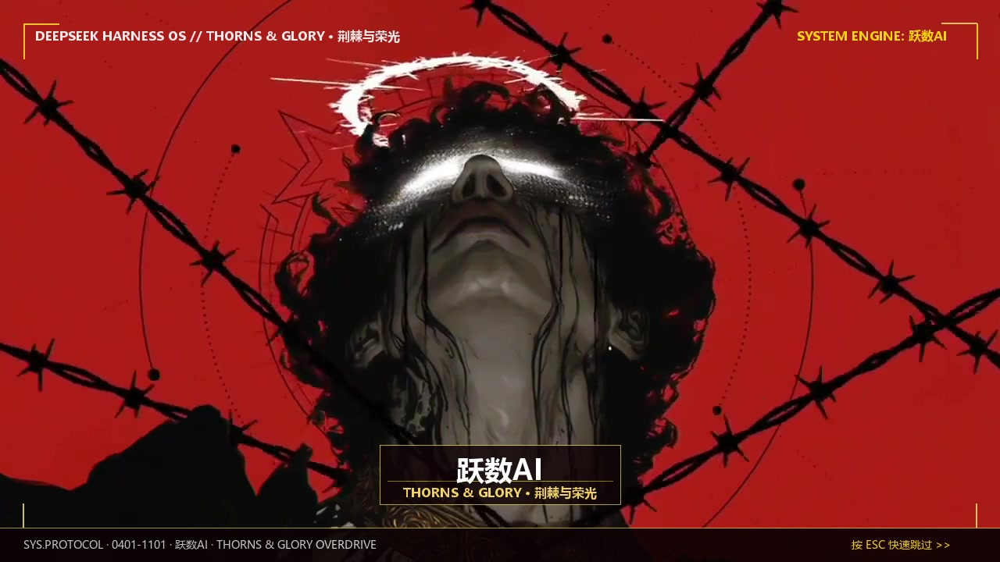

<div align="center">

# 🐳 DeepSeek Harness 皮肤 · 超燃开机动画 & 管理中心

**HARNESS OS 开机动画 —— 原生 15 秒机能流光视频 · 实时小窗预览 · 跃数AI 中转站特惠直达**

`v1.2.0` · `Windows` · `MIT` · 作者 **跃数AI**（1.0 灵感来源：**抖音 @孤影**）

<br>


</div>

---

## ⚡ 极速安装（推荐：把提示词直接复制丢给 AI 即可！）

你正在使用 **DSH 内置 AI**、**Claude**、**Cursor**、**ChatGPT** 或任何 AI 编程助手吗？  
直接复制下面这段话，**一键发给 AI，它会全自动帮你装好**：

> ```text
> 帮我安装这个 DeepSeek Harness 开屏皮肤插件：
> https://gitee.com/leapai/deepseek-harness-plus.git
> 
> 1. 克隆仓库到本地；
> 2. 运行仓库里的 install.ps1，装到 desktop profile；
> 3. 如果找不到 dsh 命令，自动搜索 resources\runtime\cli\bin\dsh.cmd 并重试；
> 4. 安装完成后告诉我如何重启 DSH 查看超燃开机动画。
> ```

*AI 会全自动完成找路径、添加依赖与注册，你只需在提示完成后重启软件即可！*

---

## 🎬 经典 & 超燃内置开机动画主题

安装包内**已完整预装所有高清视频文件**，无需额外下载任何资源，开箱即用：

| 主题名称 | 风格类型 | 时长与特点 | 视觉风格 |
| :--- | :---: | :--- | :---: |
| 🔥 **超燃写轮眼** *(默认推荐)* | 1080P 超燃视频 | **15.0 秒平滑循环** · 黑红机能流光 + 重低音原声 + 尾部音画平滑淡出 | 霸气流光 · 极致震撼 |
| 👑 **荆棘与荣光** *(暗黑新品)* | 720P 圣冠视频 | **15.0 秒平滑循环** · 暗黑救赎 + 荆棘铁丝圣环 + 跃数AI金色铭牌 | 艺术暗黑 · 恢宏质感 |
| ❄️ **苍天之瞳** | 720P 苍眸视频 | **15.0 秒平滑循环** · 五条悟六眼苍眸 + 赛博机能面罩标 (无量空处) | 苍蓝闪电 · 凌厉帅气 |
| 🐳 **经典科技蓝鲸** | 纯 CSS/SVG 代码 | **16.0 秒电影自检** · 鲸鱼亮起 → 访问许可 → 身份确认 → 读取 → WELCOME | 原汁原味 · 极客自检 |
| 🎬 **自定义本地视频** | 本地视频 DIY | 放入任意 `.mp4` 即可自动识别，自由打造属于你的个性开机动画 | 自由度 100% |

<div align="center">
  
  <p><em>（暗黑系新品：👑 荆棘与荣光 开屏效果）</em></p>
</div>

---

## 🎛️ 全新管理界面功能 (DSH 设置 → 开屏动画)

控制面板采用赛博暗黑极光美学，功能一目了然：

<div align="center">
  
</div>

### 🌟 四大核心管理特性：
1. **🚀 跃数AI 中转站 (ys666.site) 专属特惠中心**：
   - 官方千人专线，注册即送免费测试额度，折上折特惠充值；
   - 支持一键直达官网、一键复制官网链接。
2. **🎬 实时效果小窗预览（所见即所得）**：
   - 在设置面板中即可直接循环预览视频动画；
   - 独立的小窗原声静音/开启控制，无需全屏即可感知视听效果。
3. **✏️ 自由自定义开机文字 / 品牌名称**：
   - 支持自由输入你的专属名字或个性网名，实时联动显示在自检过场与视频浮标上。
4. **📂 DIY 极速一键打开视频目录**：
   - 点击「一键打开视频目录」直接呼出 Windows 资源管理器，拖入视频一秒生效。

---

> ### 🚀 跃数AI中转站 · 稳定运行中的千人 AI 中转站
>
> **一个 Key，接入 DeepSeek / GLM / Kimi / MiniMax / Claude / GPT 等全网主流大模型。**
> 长期稳定 · 超低延迟 · 不掉线 —— 无论跑 Agent、写代码、打比赛还是日常办公，一个中转全部搞定！
>
> 👉 **[立即访问 ys666.site](https://ys666.site)**

---

## 🛠️ 其他安装方式（手动 / 双击）

### 方法一 · 双击安装（新手首选，仅需三步）

**① 下载仓库**
在 Gitee / GitHub 页面点击 **「克隆/下载」→「下载 ZIP」**，解压到任意文件夹。

**② 双击 `一键安装.bat`**
脚本会自动寻找你的 DSH 安装目录，自动完成插件注入。看到绿色的「安装完成」即成功。

**③ 完全退出 DSH，再重新打开**
关掉主窗口后，在 Windows 右下角**系统托盘**右键 DSH 图标选择「退出」，然后重新打开即可！

---

### 方法二 · 终端命令行安装

以普通权限或管理员权限打开 PowerShell：

```powershell
git clone https://gitee.com/leapai/deepseek-harness-plus.git
cd deepseek-harness-plus
powershell -NoProfile -ExecutionPolicy Bypass -File .\install.ps1
```

> **便携版用户（Portable）**：若你的 DSH 装在自定义目录（如 `D:\deepseek`），指定 CLI 即可：
> ```powershell
> powershell -NoProfile -ExecutionPolicy Bypass -File .\install.ps1 -Dsh "D:\deepseek\resources\runtime\cli\bin\dsh.cmd"
> ```

---

## 🎥 如何 DIY 添加自己的新视频动画？

不需要重新打包代码，任何人都能一秒换成自己的动漫/游戏剪辑视频：

1. 打开 DSH **设置 → 开屏动画**，在「DIY 本地视频换源教程」卡片中点击 **「📂 一键打开视频目录」**；
2. 此时 Windows 资源管理器会自动弹出用户视频文件夹：
   ```text
   C:\Users\你的用户名\.dsh-whale-splash\videos\
   ```
3. 把你准备好的任意 `.mp4` 或 `.webm` 格式视频丢进去（如 `genshin.mp4`、`cyberpunk.mp4`）；
4. 切换一下设置面板，在「选择开机动画风格」中**会自动出现你新增的视频卡片**，点击即可在上方小窗预览并选定！

---

## 🗑️ 卸载

随时可以完全卸载，恢复 DSH 原始默认状态：

```powershell
& "你的DSH路径\resources\runtime\cli\bin\dsh.cmd" plugin --profile desktop remove dsh-whale-splash
```

---

<div align="center">

## 📄 关于与致谢

作者 **跃数AI**　·　1.0 灵感来源：**抖音 @孤影**　·　代码开源协议 [MIT](LICENSE)

本项目由 **[跃数AI中转站 · ys666.site](https://ys666.site)** 倾力研发与支持！

**一个 Key 聚合全网大模型，超低延迟专线加速，注册即送测试额度：[ys666.site](https://ys666.site) ✨**

</div>
