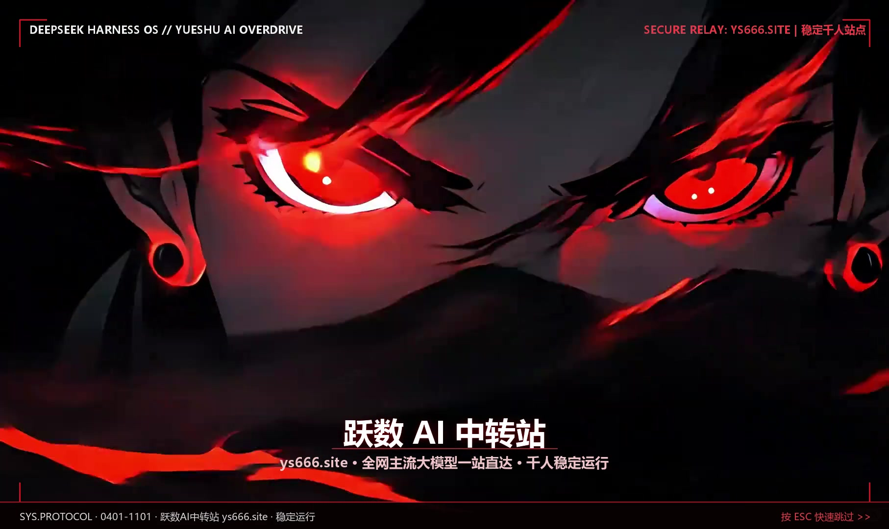
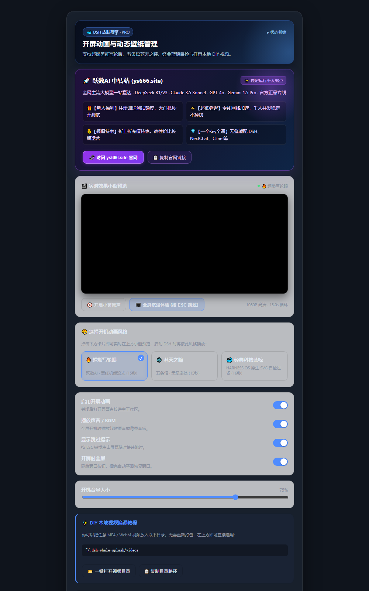
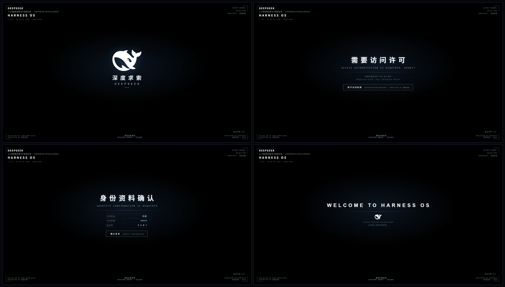

<div align="center">

# 🐳 DeepSeek Harness 皮肤 · 超燃开机动画 & 管理中心

**HARNESS OS 开机动画 —— 原生超燃 15 秒机能流光视频 · 实时小窗预览 · 跃数AI 中转站特惠直达**

`v1.2.0` · `Windows` · `MIT` · 作者 **抖音 @孤影**

<br>



</div>

---

## ✨ 这是什么

一个专为 **DeepSeek Harness（DSH）** 打造的高颜值沉浸式开机动画皮肤与管理系统：
每次启动 DSH，都会先展示一段极具未来科技感与电影级视觉冲击的开机过场，随后自然淡出并无缝进入 DSH 主工作区。

在 `v1.2.0` 版本中，不仅支持了**原汁原味的 15 秒超燃机能流光视频**，还重构上线了全新的**图形化管理控制面板**（支持实时小窗预览、多主题一键切换、一键打开本地视频换源目录），并深度集成了 **跃数AI 中转站 (ys666.site)** 官方特惠入口！

> 皮肤只负责「开机过场」与「视觉呈现」，**绝不触碰你的模型配置、聊天记录或 API Key**。

---

## 🎛️ 全新管理界面预览 (设置 → 开屏动画)

全新的设置控制面板采用赛博暗黑极光美学，功能一目了然：

<div align="center">
  
</div>

### 🌟 核心管理特性：
1. **🚀 跃数AI 中转站 (ys666.site) 专属特惠中心**：
   - 官方千人专线，注册即送免费额度，折上折充值优惠；
   - 支持一键直达官网、一键复制官网链接。
2. **🎬 实时效果小窗预览（所见即所得）**：
   - 在设置面板中即可直接循环预览视频动画；
   - 独立的小窗原声静音/开启控制，无需全屏即可感知视觉与听觉效果。
3. **🎨 现代卡片式风格选择器**：
   - 网格化大卡片切换，高亮状态指示。
4. **📂 DIY 极速一键打开视频目录**：
   - 点击「一键打开视频目录」直接呼出 Windows 资源管理器，拖入视频一秒生效。

---

## 🎬 内置开机动画主题

在 DSH **设置 → 开屏动画** 中即可一键无缝切换：

| 主题名称 | 风格类型 | 时长与特点 | 推荐度 |
| :--- | :---: | :--- | :---: |
| 🔥 **超燃写轮眼** *(默认推荐)* | 1080P 超燃视频 | **15.0 秒平滑循环** · 黑红机能流光 + 重低音原声 + 尾部音画淡出 | ⭐⭐⭐⭐⭐ (极度震撼) |
| ❄️ **苍天之瞳** | 720P 苍眸视频 | **15.0 秒平滑循环** · 五条悟六眼苍眸 + 赛博机能面罩标 (无量空处) | ⭐⭐⭐⭐⭐ (利落帅气) |
| 🐳 **经典科技蓝鲸** | 纯 CSS/SVG 代码 | **16.0 秒电影自检** · 鲸鱼亮起 → 访问许可 → 身份确认 → 读取 → WELCOME | ⭐⭐⭐⭐ (原汁原味极客) |
| 🎬 **自定义本地视频** | 本地视频 DIY | 放入任意 `.mp4` 即可自动识别，自由打造属于你的个性开机动画 | ⭐⭐⭐⭐⭐ (自由度 100%) |

<br>

<div align="center">
  
  <p><em>（附：经典科技蓝鲸纯代码动画定格）</em></p>
</div>

---

> ### 🚀 跃数AI中转站 · 稳定运行中的千人 AI 中转站
>
> **一个 Key，接入 DeepSeek / GLM / Kimi / MiniMax / Claude / GPT 等全网主流大模型。**
> 长期稳定 · 超低延迟 · 不掉线 —— 无论跑 Agent、写代码、打比赛还是日常办公，一个中转全部搞定！
>
> 👉 **[立即访问 ys666.site](https://ys666.site)**

---

## 🚀 安装方法

### 方法一 · 把仓库地址丢给 AI 助手（最省事，推荐）

复制下面这段话，发给你正在使用的任意 AI（DSH 内置 AI、Claude、Cursor、ChatGPT 均可）：

```text
帮我安装这个 DeepSeek Harness 皮肤：
https://gitee.com/leapai/deepseek-harness-plus.git

1. 克隆仓库到本地；
2. 运行仓库里的 install.ps1，装到 desktop profile；
3. 如果提示找不到 dsh，就搜索 resources\runtime\cli\bin\dsh.cmd，再用 -Dsh 参数重试；
4. 装完告诉我怎么重启 DSH 才能看到开机动画。
```

---

### 方法二 · 双击安装（新手首选，仅需三步）

**① 下载仓库**
在 Gitee 页面点击 **「克隆/下载」→「下载 ZIP」**，解压到任意文件夹。

**② 双击 `一键安装.bat`**
脚本会自动寻找你的 DSH 安装目录，自动完成插件注入。看到绿色的「安装完成」即成功。

**③ 完全退出 DSH，再重新打开**
关掉主窗口后，在 Windows 右下角**系统托盘**右键 DSH 图标选择「退出」，然后重新打开即可！

---

### 方法三 · 终端命令行安装

以管理员或普通权限打开 PowerShell：

```powershell
git clone https://gitee.com/leapai/deepseek-harness-plus.git
cd deepseek-harness-plus
powershell -NoProfile -ExecutionPolicy Bypass -File .\install.ps1
```

> **便携版用户（Portable）**：若你的 DSH 装在自定义目录（如 `D:\deepseek`），指定 CLI 即可：
> ```powershell
> powershell -NoProfile -ExecutionPolicy Bypass -File .\install.ps1 -Dsh "D:\deepseek\resources\runtime\cli\bin\dsh.cmd"
> ```

---

## 🎥 如何 DIY 添加自己的新视频动画？

不需要重新打包代码，任何人都能一秒换成自己的动漫/游戏剪辑视频：

1. 打开 DSH **设置 → 开屏动画**，在「DIY 本地视频换源教程」卡片中点击 **「📂 一键打开视频目录」**；
2. 此时 Windows 资源管理器会自动弹出用户视频文件夹：
   ```text
   C:\Users\你的用户名\.dsh-whale-splash\videos\
   ```
3. 把你准备好的任意 `.mp4` 或 `.webm` 格式视频丢进去（如 `genshin.mp4`、`cyberpunk.mp4`）；
4. 切换一下设置面板，在「选择开机动画风格」中**会自动出现你新增的视频卡片**，点击即可在上方小窗预览并选定！

---

## 🗑️ 卸载

随时可以完全卸载，恢复 DSH 原始默认状态：

```powershell
& "你的DSH路径\resources\runtime\cli\bin\dsh.cmd" plugin --profile desktop remove dsh-whale-splash
```

---

## 📁 目录结构

```
deepseek-harness-plus/
├─ README.md                        ← 完整说明、管理后台使用指南与 DIY 教程
├─ CHANGELOG.md                     ← 版本更新日志
├─ AGENTS.md                        ← 专供 AI Agent 解析的安装指南
├─ 一键安装.bat                      ← 双击一键安装入口
├─ install.ps1                      ← 跨路径智能检测 PowerShell 安装脚本
├─ docs/                            ← 效果预览与管理后台截图
│  ├─ settings_preview.png          ← 全新设置管理面板与特惠中心截图
│  ├─ video_preview.jpg             ← 超燃红眸 15 秒视频开机效果图
│  └─ preview.png                   ← 经典科技蓝鲸定格图
├─ release/
│  └─ dsh-whale-splash-1.2.0.tgz    ← 包含完整双高清视频的预打包安装包
└─ plugin/                          ← 皮肤完整源码
   ├─ package.json                  ← 模块与 Patch 声明
   ├─ index.js                      ← 宿主端：Range 视频流、健康探测、打开文件夹系统服务
   ├─ client.js                     ← 浏览器端：管理面板UI、实时小窗播放器、HUD 渲染
   ├─ cordis.patch.yml              ← DSH 挂载配置
   └─ assets/                       ← 预制 15s 高画质视频与音频资产
```

---

<div align="center">

## 📄 关于与致谢

作者 **抖音 @孤影**　·　代码开源协议 [MIT](LICENSE)

感谢 **[跃数AI中转站 · ys666.site](https://ys666.site)** 对本项目的支持！

**如果这个超燃皮肤让你每次打开 DSH 都眼前一亮，欢迎在抖音点个关注 ✨**

</div>
